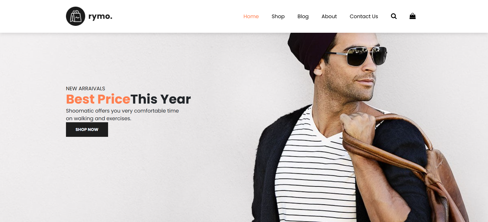
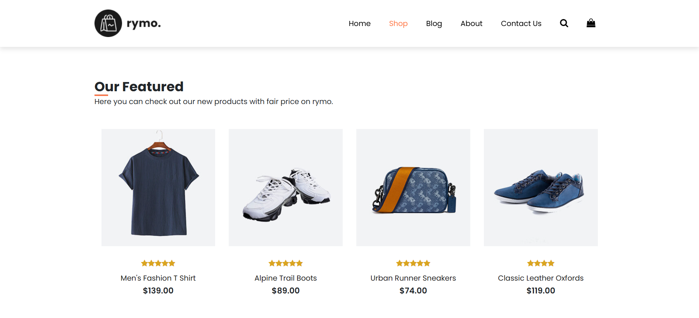
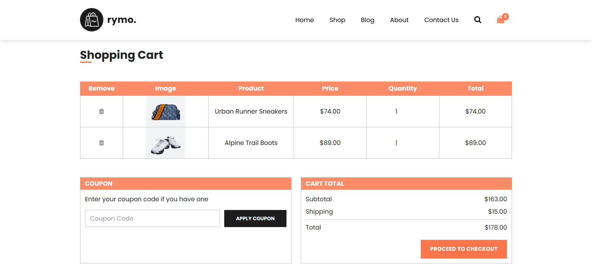
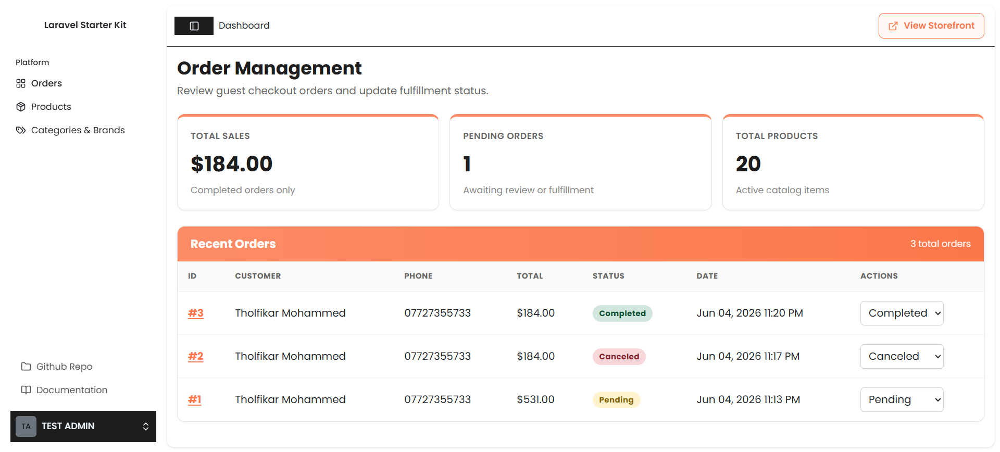
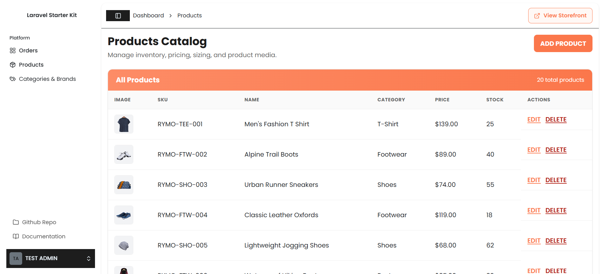
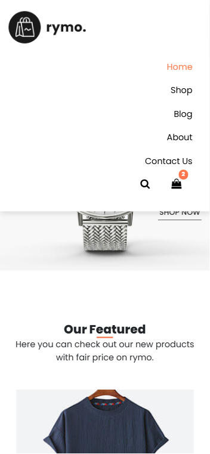

<div align="center">

# Rymo Store

### Full-stack e-commerce portfolio project — Vue 3, TypeScript, Inertia.js and Laravel.

[](https://laravel.com)
[](https://vuejs.org)
[](https://www.typescriptlang.org)
[](https://inertiajs.com)
[](https://tailwindcss.com)
[](https://www.mysql.com)
[](https://www.php.net)
[](https://nginx.org)

**Previously deployed on a DigitalOcean Ubuntu VPS (demo currently offline)** · Laravel + Inertia + Vue 3 + TypeScript + MySQL

[Interface Preview](#interface-preview) · [Repository Structure](#-repository-map)

</div>

---

## 🚀 Project Overview

**Rymo Store** is a full-stack e-commerce portfolio project delivered as a **single deployable monolith**—combining a reactive Vue 3 storefront with a disciplined Laravel backend, bridged by Inertia.js v2.

Unlike split API/SPA architectures that multiply deployment surfaces and contract drift, Rymo preserves **one codebase, one deployment unit, and one source of truth**—while still delivering SPA-grade interactivity on the client.

| Capability | Implementation |
|------------|----------------|
| **Customer experience** | Guest checkout, paginated catalog, product galleries, size-aware PDP, persistent cart |
| **Back-office operations** | Auth-protected dashboard with real-time CRUD for products, categories, and brands |
| **Commerce integrity** | Immutable `price_at_purchase`, transactional checkout, server-authoritative pricing |
| **Media pipeline** | Admin product image uploads to public storage with gallery management |
| **Quality gates** | Pest PHP feature tests across storefront, checkout, and dashboard modules |

Built as a portfolio project to demonstrate storefront UX, dashboard interfaces, and full-stack application design.

---

## Interface Preview

> Screenshots of the locally running application. The former hosted demo is no longer available.

> Add the screenshots to `docs/screenshots/` before publishing this section.

### Storefront


### Product Catalog


### Shopping Cart


### Admin Dashboard


### Product Management


### Mobile Experience


### Application Routes (when running locally)

| Storefront | Route | Admin | Route |
|---|---|---|---|
| Home | `/` | Dashboard | `/dashboard` |
| Shop | `/shop` | Products | `/dashboard/products` |
| Product detail | `/shop/{slug}` | Categories & brands | `/dashboard/categories` |
| Cart | `/cart` | | |
| Checkout | `/checkout` | | |

---

## 📊 Admin Dashboard Preview

The admin panel is a **comprehensive back-office CMS** built on Tailwind CSS and shadcn-vue components within the Inertia shell—giving operators SPA-like workflows without a separate admin SPA codebase.

### Orders Management
- Real-time KPI cards: total sales, pending orders, catalog count
- Paginated order table with expandable line-item drill-down
- Inline status updates (`pending` → `completed` / `canceled`) via Inertia partial reloads

### Products Catalog
- Full CRUD with TypeScript-typed Inertia forms and validation error surfacing
- Category and brand assignment via relational dropdowns
- Clothing and footwear size matrices (`available_sizes` JSON)
- **Device-native image uploads** — main thumbnail + multi-image gallery (no manual path entry)

### Categories & Brands
- Tabbed taxonomy management with reusable modal forms
- Slug auto-generation with uniqueness validation
- Safe-delete guards — entities with dependent products cannot be removed

### Operator UX
- Sidebar navigation across Orders · Products · Categories & Brands
- **View Storefront** header action — one click back to the storefront
- Modal-driven create/edit flows with `useForm` — no full-page reloads

---

## 🛠️ Technical & Architectural Highlights

### State Management & Performance

Cart operations are **client-first** to eliminate unnecessary database round-trips during browsing sessions.

```
Browser Session                    Server (on checkout only)
─────────────────                  ─────────────────────────
useCart composable                 OrderController@store
    │                                      │
    ▼                                      ▼
localStorage persistence          DB::transaction()
reactive Vue computed totals      authoritative price lookup
add / remove / quantity           stock + catalog validation
```

- Shopping intent lives in a **Vue 3 composable** (`useCart`) backed by **`localStorage` persistence**—cart mutations are instant with zero DB I/O during browse/add/remove cycles.
- Subtotals, shipping, and totals are derived via **`computed` reactivity**—no redundant API calls.
- The database is touched only at **checkout commit**, when the server validates product IDs, recalculates totals from `products.price`, and atomically persists the order ledger.

**Result:** Dramatically reduced database load during high-traffic browse sessions while preserving server authority at the transaction boundary.

---

### Data Integrity & Security

Guest checkout is engineered for **financial correctness under concurrency**.

```php
DB::transaction(function () use ($validated, $cartItems) {
    // 1. Re-fetch products from DB — never trust client prices
    // 2. Validate stock and catalog existence
    // 3. Persist order + order_items with frozen price_at_purchase
    // 4. Snapshot analytics cart linked via order_id
});
```

| Rule | Enforcement |
|------|-------------|
| **Price authority** | `OrderController` reads live `products.price` — `localStorage` prices are ignored |
| **Atomicity** | Entire checkout wrapped in `DB::transaction()` |
| **Immutable ledger** | `order_items.price_at_purchase` frozen at checkout millisecond |
| **Catalog safe-delete** | Products on existing orders cannot be deleted; categories/brands with products are protected |
| **Auth boundary** | Dashboard routes behind `auth` + `verified` middleware |

---

### Clean Code & Typing

The monolith maintains **type safety across the server–client boundary** without maintaining a separate OpenAPI contract.

| Layer | Typing Strategy |
|-------|-----------------|
| **Frontend** | TypeScript interfaces in `resources/js/types/` — `shop.ts`, `dashboard.ts`, `catalog.ts` |
| **Shared props** | Inertia page props typed via `defineProps<{}>()` on every page component |
| **Server shape** | Eloquent API Resources (`ProductDashboardResource`, `OrderDashboardResource`, …) enforce consistent JSON contracts |
| **Routing** | Ziggy generates type-aware `route()` helpers inside Vue templates |
| **Validation** | Laravel request validation with structured error bags surfaced in Inertia forms |

**Outcome:** A type-safe monolith where prop contracts, form payloads, and API resource shapes stay aligned—catching integration bugs at compile time, not in production.

---

## ⚙️ Previous Deployment & DevOps Stack

The application **was previously deployed** on a self-managed DigitalOcean Ubuntu VPS. The server has since been deleted; the topology below documents the former deployment.

### Infrastructure Topology

```
Internet
    │
    ▼
┌─────────────┐
│   Nginx     │  Reverse proxy · SSL termination · static asset caching
│  :80 / :443 │
└──────┬──────┘
       │
       ├──► /          → Laravel public/index.php
       ├──► /storage   → Symlinked product uploads
       └──► /build      → Vite production manifest
              │
              ▼
       ┌─────────────┐
       │ PHP 8.3-FPM │  Process-isolated worker pool · Unix socket to Nginx
       └──────┬──────┘
              │
              ▼
       ┌─────────────┐
       │  MySQL 8    │  Native connection pooling · InnoDB transactional engine
       └─────────────┘
```

### DevOps Decisions

| Component | Configuration |
|-----------|---------------|
| **Nginx** | Reverse proxy to PHP-FPM; `try_files` fallback to Laravel front controller; gzip for static assets |
| **PHP 8.3-FPM** | Isolated worker processes; tuned `pm` pool settings for VPS memory envelope |
| **Node.js / Vite** | Production build with memory ceiling: `NODE_OPTIONS="--max-old-space-size=4096" npm run build` |
| **MySQL** | Dedicated database user with least-privilege grants; InnoDB for transactional checkout |
| **Laravel** | `php artisan migrate --force` · `php artisan storage:link` · `config:cache` · `route:cache` · `view:cache` |
| **File uploads** | `storage/app/public/products/` served via `/storage/products/...` symlink |

### Deployment Workflow (Summary)

```bash
# On VPS — illustrative production deploy sequence
git pull origin main
composer install --no-dev --optimize-autoloader
npm ci && NODE_OPTIONS="--max-old-space-size=4096" npm run build
php artisan migrate --force
php artisan storage:link    # first deploy only
php artisan config:cache && php artisan route:cache && php artisan view:cache
sudo systemctl reload php8.3-fpm && sudo systemctl reload nginx
```

---

## 🧰 Tech Stack

| Layer | Technology |
|-------|------------|
| Runtime | PHP 8.3-FPM · Node.js 18+ |
| Framework | Laravel 12 |
| Frontend | Vue 3 · TypeScript · Vite 6 |
| Bridge | Inertia.js v2 · Ziggy v2 |
| Admin UI | Tailwind CSS 3 · shadcn-vue · Radix Vue |
| Storefront UI | Bootstrap 4 heritage + custom CSS (brand-faithful migration) |
| Database | MySQL 8 |
| Testing | Pest PHP 3 |
| Previous hosting (offline) | DigitalOcean Ubuntu VPS · Nginx |

---

## 📁 Repository Map

```
rymo-ecommerce/
├── app/Http/Controllers/
│   ├── ShopController.php          # Storefront catalog
│   ├── OrderController.php         # Guest checkout (DB::transaction)
│   ├── DashboardController.php     # Order management
│   ├── ProductController.php       # Product CRUD + image uploads
│   ├── CategoryController.php      # Category CRUD
│   └── BrandController.php         # Brand CRUD
├── app/Http/Resources/             # Typed JSON contracts (storefront + dashboard)
├── app/Support/
│   ├── StorefrontCatalog.php       # Canonical seed data
│   └── ProductImageStorage.php     # Public disk upload helper
├── resources/js/
│   ├── composables/useCart.ts      # localStorage cart (zero DB I/O while browsing)
│   ├── pages/Dashboard/            # Products.vue · Catalog.vue
│   └── types/                      # TypeScript domain contracts
├── database/data/storefront-catalog.php
├── routes/web.php                  # Storefront + dashboard route groups
└── tests/Feature/                  # Pest — storefront, checkout, dashboard
```

---

## 🧪 Local Development

```bash
git clone https://github.com/Zolfikaar/rymo-store.git && cd rymo-store
composer install && npm install
cp .env.example .env && php artisan key:generate
php artisan migrate:fresh --seed  # destructive: use only with a disposable local database
php artisan storage:link
composer run dev   # artisan serve + vite + queue listener
```

```bash
php artisan test --compact
```

---

## 🗺️ Roadmap

- [x] Guest checkout with transactional integrity
- [x] Admin dashboard — orders, products, categories, brands
- [x] Product image uploads (main + gallery)
- [x] Previous VPS deployment (DigitalOcean; currently offline)
- [ ] Product variant matrix (`product_variants` parent–child model)
- [ ] Multi-currency engine (USD / IQD)
- [ ] Arabic / English localization with RTL support

---

## 📜 License

Licensed under the **[MIT License](LICENSE)**, if the repository includes the linked license file.

---

<div align="center">

**Rymo Store — Vue 3 · TypeScript · Inertia.js · Laravel**

[⬆ Back to Top](#rymo-store)

</div>
